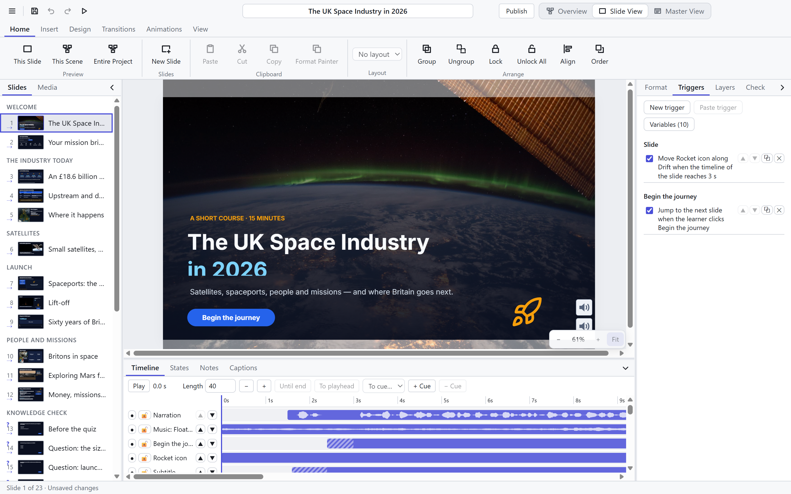
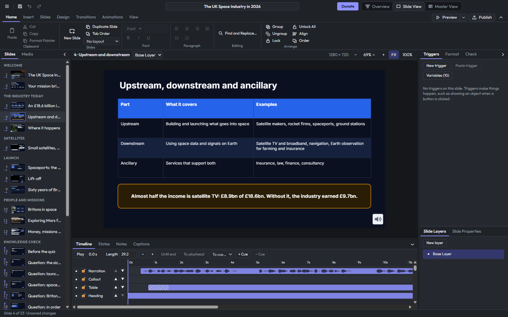

[](https://ko-fi.com/H4S12B9OKI)
# Vedra Opus

Vedra Opus is a desktop app for building interactive eLearning courses: slides, layers and triggers, quizzes, audio and video, and publishing to SCORM, xAPI, cmi5 or plain HTML.

This repository is where its test builds are published, so you can download and try them. The source code is at **[lpgeach/vedra-opus-source](https://github.com/lpgeach/vedra-opus-source)**, under the GNU General Public License, version 3 or later.

[](https://github.com/sponsors/lpgeach)





_The editor in its light and dark themes, with the demo course, The UK Space Industry in 2026._

## ⬇️ Download

**Latest: [Vedra Opus 0.1.0 alpha 6](https://github.com/lpgeach/vedra-opus-releases/releases/tag/v0.1.0-alpha.6)** for Windows, macOS and Linux.

📖 **New here?** [The Vedra Opus help](help/README.md) covers every feature, with pictures from the app.

### Windows 10 or 11 (64-bit)

1. Download **[`Vedra-Opus-0.1.0-alpha.6-x64.exe`](https://github.com/lpgeach/vedra-opus-releases/releases/download/v0.1.0-alpha.6/Vedra-Opus-0.1.0-alpha.6-x64.exe)** (238 MB).
2. Run it. The alpha is **not signed** yet, so Windows shows "Windows protected your PC": choose **More info → Run anyway**.
3. Choose where to install it, and start Vedra Opus from the Start menu.

### macOS 11 or later

1. Download the one for your Mac:
   - **Apple Silicon** (M1 and later): **[`Vedra-Opus-0.1.0-alpha.6-arm64.dmg`](https://github.com/lpgeach/vedra-opus-releases/releases/download/v0.1.0-alpha.6/Vedra-Opus-0.1.0-alpha.6-arm64.dmg)** (275 MB)
   - **Intel**: **[`Vedra-Opus-0.1.0-alpha.6-x64.dmg`](https://github.com/lpgeach/vedra-opus-releases/releases/download/v0.1.0-alpha.6/Vedra-Opus-0.1.0-alpha.6-x64.dmg)** (292 MB)
   - Not sure? Apple menu → About This Mac: "Chip: Apple M…" is Apple Silicon; "Processor: Intel" is Intel.
2. Open it and drag **Vedra Opus** into **Applications**.
3. The alpha is **not notarised by Apple** yet, so the first time macOS will not open it. Try opening it once, then go to **System Settings → Privacy & Security** and choose **Open Anyway** beside Vedra Opus.

### Linux (64-bit)

Choose one:

- **AppImage**, for most distributions: download **[`Vedra-Opus-0.1.0-alpha.6-x86_64.AppImage`](https://github.com/lpgeach/vedra-opus-releases/releases/download/v0.1.0-alpha.6/Vedra-Opus-0.1.0-alpha.6-x86_64.AppImage)** (288 MB), make it executable (`chmod +x Vedra-Opus-0.1.0-alpha.6-x86_64.AppImage`) and run it. If it does not start, install FUSE 2 (on Ubuntu 24.04: `sudo apt install libfuse2t64`).
- **Debian or Ubuntu package:** download **[`Vedra-Opus-0.1.0-alpha.6-amd64.deb`](https://github.com/lpgeach/vedra-opus-releases/releases/download/v0.1.0-alpha.6/Vedra-Opus-0.1.0-alpha.6-amd64.deb)** (231 MB), then `sudo apt install ./Vedra-Opus-0.1.0-alpha.6-amd64.deb`.

For text-to-speech on Linux, install espeak-ng (`sudo apt install espeak-ng`). The Linux version is built and tested on a current Ubuntu; much older distributions may not run it.

### Checking a download

Their SHA-256:

```
22935c381eed2cc41fd5faa82ec54b33d451e382abbad92ca0dcfa3afba29779  Vedra-Opus-0.1.0-alpha.6-x64.exe
ee09748cd74e05b3541a9b72a996efe09652df8c9d3e6f108471641953e6871f  Vedra-Opus-0.1.0-alpha.6-arm64.dmg
6bd5dec4915676df829d0a2eef1f10e5523b7aef5055255e9862609243225f55  Vedra-Opus-0.1.0-alpha.6-x64.dmg
d790e6aa9cb4d39c853276b4195b62445c2c159764b894483a97a3310a1002c9  Vedra-Opus-0.1.0-alpha.6-x86_64.AppImage
97c1be4925e0591b096928aab9beeb5b547826e6b1f116880a519b14a6d322fe  Vedra-Opus-0.1.0-alpha.6-amd64.deb
```

In PowerShell: `Get-FileHash .\Vedra-Opus-0.1.0-alpha.6-x64.exe`. In the macOS Terminal: `shasum -a 256 Vedra-Opus-0.1.0-alpha.6-arm64.dmg`. On Linux: `sha256sum Vedra-Opus-0.1.0-alpha.6-x86_64.AppImage`.

## 🚀 Getting started

- On the Welcome screen, **Explore the Demo Course** opens a finished sample course to look through, preview and change.
- **New Project** starts a blank course; **New from Template…** starts from one of the starter templates.
- **Import PowerPoint…** and **Import Storyline Course…** bring in existing material.

## ⚠️ This is an alpha

- Things will be missing and some will break. Keep copies of projects you care about.
- **Projects** from alpha 5 open in alpha 6, and the other way round. **Projects saved in alpha 5 or 6 cannot be opened in alpha 4 or earlier,** because they use a newer project format.
- **Updates:** **Help → Check for Updates** finds new versions here on Windows (from alpha 4) and in the Linux AppImage (from alpha 5). On macOS, with the .deb, and from alpha 3 or earlier, download new versions from this repository's [Releases](https://github.com/lpgeach/vedra-opus-releases/releases) page.

## 📦 Third-party source

Vedra Opus ships ffmpeg (LGPL 2.1 or later) and LibreOffice (MPL 2.0). The complete source of both, exactly as built for each version, is published here alongside it: for alpha 6, **[Third-party source for Vedra Opus 0.1.0 alpha 6](https://github.com/lpgeach/vedra-opus-releases/releases/tag/sources-0.1.0-alpha.6)**. You do not need it to install or use the app.

**Help → Third-Party Notices…** in the app lists every licence, including the demo course's music and pictures.

## 💜 Support Vedra Opus

If Vedra Opus is useful to you, you can support its development through GitHub Sponsors:

[](https://github.com/sponsors/lpgeach)
